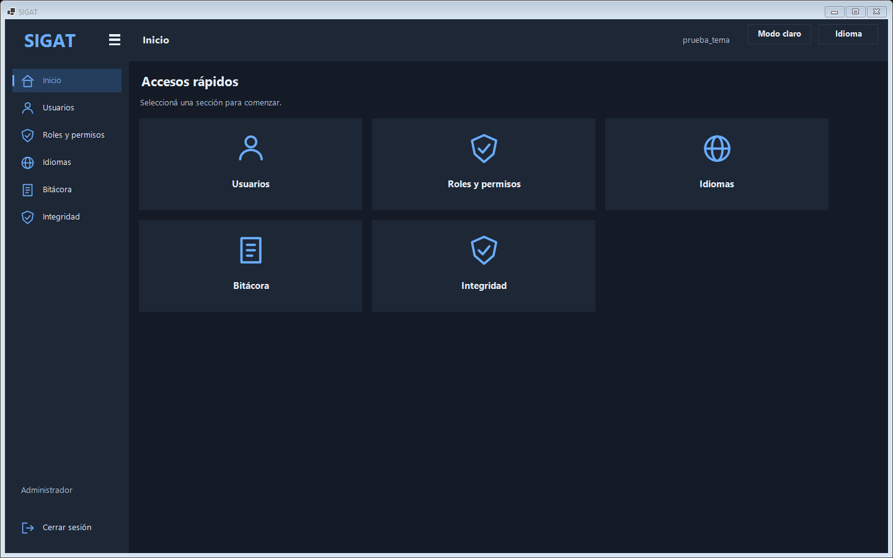
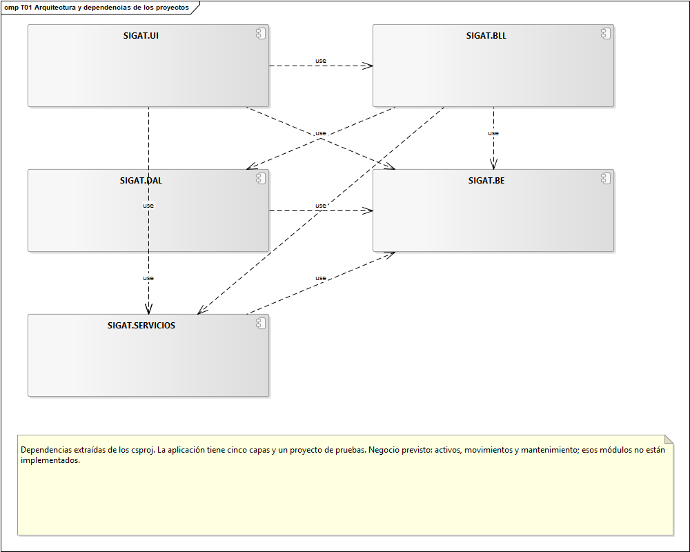

# SIGAT

**Sistema de Gestión de Activos Tecnológicos**

Proyecto universitario de Ingeniería de Software · Universidad Abierta Interamericana


SIGAT es una aplicación de escritorio desarrollada como proyecto académico para aplicar análisis, diseño orientado a objetos, arquitectura en capas, patrones de diseño y persistencia en SQL Server. Este repositorio contiene el código fuente, las pruebas automatizadas y los scripts de preparación de la base de datos.

**Accesos rápidos:** [Instalación](#requisitos-e-instalación) · [Modelo de Enterprise Architect](EA-Diagramas/Actual/SIGAT_Modelo_Actualizado.EAP) · [Diagramas](#diagramas-y-documentación) · [Guía de integridad](Querys/GUIA_INTEGRIDAD.md) · [Demostración](#recorrido-para-la-demostración)

> **Estado actual:** están implementados los módulos administrativos y técnicos, incluido el historial de cuentas de usuario de T06b. La gestión operativa de activos continúa pendiente.



*Vista del inicio con una cuenta de prueba. Los accesos disponibles dependen de los permisos de la cuenta.*

## Datos académicos

| Dato | Información |
|---|---|
| Universidad | Universidad Abierta Interamericana (UAI) |
| Facultad | Tecnología Informática |
| Materia | Ingeniería de Software |
| Docente | Juan Ignacio Silva |
| Integrantes | Federico Agustin Burgos y Valentina Nicole Planas Stredel |
| Comisión | 3-J · turno noche · localización Centro |
| Período | Segundo cuatrimestre de 2026 |

## Contenido

- [Propósito y alcance](#propósito-y-alcance)
- [Funcionalidades implementadas](#funcionalidades-implementadas)
- [Interfaz y uso cotidiano](#interfaz-y-uso-cotidiano)
- [Arquitectura del proyecto](#arquitectura-del-proyecto)
- [Patrones de diseño](#patrones-de-diseño)
- [Roles y permisos](#roles-y-permisos)
- [Requisitos e instalación](#requisitos-e-instalación)
- [Integridad y recuperación](#integridad-y-recuperación)
- [Pruebas automatizadas](#pruebas-automatizadas)
- [Recorrido para la demostración](#recorrido-para-la-demostración)
- [Diagramas y documentación](#diagramas-y-documentación)
- [Estado de la tercera entrega](#estado-de-la-tercera-entrega)

## Propósito y alcance

El propósito general de SIGAT es centralizar la gestión de los activos tecnológicos de una organización: identificar los equipos, conocer su ubicación y responsable, y seguir sus movimientos, estado y mantenimiento durante su ciclo de vida.

**La versión actual implementa la base administrativa y técnica del sistema:** autenticación, gestión de cuentas, roles y permisos, múltiples idiomas, bitácora e integridad de los datos de seguridad. Los módulos operativos de inventario de activos, movimientos, mantenimiento y reportes quedan como desarrollo futuro. Sus nombres ya forman parte del catálogo de permisos, pero todavía no cuentan con pantallas ni operaciones de negocio.

El objetivo académico es poder explicar y demostrar cómo una operación atraviesa la interfaz, las reglas de negocio y el acceso a datos, y cómo se aplican los patrones de diseño en ese recorrido.

## Funcionalidades implementadas

| Módulo | Alcance actual |
|---|---|
| Autenticación | Ingreso mediante usuario y contraseña, rechazo de credenciales incorrectas y cuentas inactivas, sesión compartida y cierre de sesión. |
| Usuarios | Alta, modificación de datos y contraseña, baja lógica y reactivación. Las cuentas nuevas se crean sin roles. |
| Roles y permisos | Tres columnas simultáneas: Usuarios, Roles y Familias y permisos. Carga sin bloquear la ventana, búsquedas independientes, edición en memoria con Guardar/Descartar, procedencia de accesos, impacto de familias compartidas y anidamiento sin ciclos. |
| Idiomas | Cambio de idioma durante la sesión, preferencia por cuenta, creación y activación de idiomas, edición e importación/exportación de traducciones. |
| Bitácora | Registro de accesos, cierre de sesión, altas, modificaciones y bajas de usuarios; intento de registro de errores inesperados y auditoría del recálculo de integridad. Consultas combinadas por fecha, usuario y actividad mediante desplegable, con compatibilidad entre nombres históricos equivalentes. |
| Control de cambios (T06b) | Historial de usuarios con autor, fecha, operación y estado de cada versión. Comparación y restauración autorizada de los datos de la cuenta y sus roles directos. |
| Integridad | DVH/DVV de Usuarios y UsuarioRol, verificación antes del acceso, respaldos comprobados, recuperación y recálculo administrativo con confirmación. |
| Presentación | Interfaz Windows Forms sencilla, modos claro y oscuro, menú lateral contraíble, accesos rápidos con íconos ampliados y formularios compatibles con el diseñador de Visual Studio. |

El administrador original está protegido contra baja, desactivación y retiro de su rol Administrador. Tampoco se permite desactivar español, el idioma activo de la sesión ni un idioma elegido por algún usuario registrado, aunque su cuenta esté inactiva.

Las traducciones se guardan en SQL por formulario y clave de control. Cuando falta una traducción, se conserva el texto de respaldo de la interfaz.

## Interfaz y uso cotidiano

- **Inicio:** accesos rápidos con íconos ampliados y nombres debajo. Se acomodan en filas según el ancho disponible.
- **Navegación:** el menú lateral permite cambiar de módulo y se puede contraer para ganar espacio. Las opciones respetan los permisos de la sesión.
- **Apariencia:** modos claro y oscuro. El tema se conserva localmente por cuenta; el idioma se guarda en SQL.
- **Roles y permisos:** se mantienen las tres columnas. Cada título identifica qué cuenta, rol o familia se está editando. Filtrar una columna conserva el borrador y las selecciones de las otras.
- **Historial:** las versiones se presentan en una vista compacta; los campos modificados se destacan en la comparación. Restaurar requiere revisar y confirmar la versión elegida.
- **Integridad:** Verificar, Crear respaldo, Recuperar y Cerrar/Continuar quedan a la vista. Las operaciones de mayor alcance se agrupan en **Opciones avanzadas**.

### Consultar la bitácora

1. Elegir una actividad en el desplegable o dejar **Todas las actividades**.
2. Opcionalmente, escribir parte del nombre de usuario. Caracteres como `_`, `%` y `[` se buscan como texto literal.
3. Para limitar el período, marcar **Fechas** y elegir desde/hasta. Si la casilla está desmarcada, las fechas no filtran; si está marcada, se incluye todo el día final.
4. Pulsar **Buscar**. Los filtros se combinan y las opciones de actividad permanecen disponibles aunque la búsqueda no devuelva registros.

Los eventos históricos `Login Exitoso` y actuales `LoginExitoso` se consultan juntos; también se agrupan `Error Crítico del Sistema` y `ErrorCritico`. Esta compatibilidad es de lectura: conserva los nombres y detalles originales de los eventos almacenados. Actividades distintas con nombres parecidos no se mezclan.

## Arquitectura del proyecto

La solución contiene cinco proyectos de aplicación y un proyecto de pruebas:

| Proyecto | Responsabilidad |
|---|---|
| [SIGAT.UI](SIGAT.UI) | Formularios, navegación, eventos, traducción de controles y temas visuales. |
| [SIGAT.BLL](SIGAT.BLL) | Reglas de negocio, validaciones y coordinación de las operaciones. |
| [SIGAT.DAL](SIGAT.DAL) | Consultas, transacciones y persistencia en SQL Server. |
| [SIGAT.BE](SIGAT.BE) | Entidades, relaciones, contratos de auditoría e informes de integridad. |
| [SIGAT.SERVICIOS](SIGAT.SERVICIOS) | Sesión, administración del idioma, hashes, cifrado y funciones compartidas. |
| [SIGAT.Tests](SIGAT.Tests) | Pruebas de lógica, interfaz, diseñador e integración con SQL Server. |

El recorrido habitual es **UI → BLL → DAL**. Las capas utilizan BE para representar datos y relaciones, y SERVICIOS para las funciones transversales. Las capas inferiores no dependen de la interfaz.



```text
SIGAT/
├── SIGAT.slnx          Solución para Visual Studio
├── SIGAT.UI/           Presentación
├── SIGAT.BLL/          Lógica de negocio
├── SIGAT.DAL/          Acceso a datos
├── SIGAT.BE/           Entidades y contratos
├── SIGAT.SERVICIOS/    Servicios compartidos
├── SIGAT.Tests/        Pruebas automatizadas
├── Querys/             Instalación y mantenimiento SQL
├── EA-Diagramas/       Modelo actual y diagramas
├── Recursos/Capturas/  Vistas de la interfaz con datos de prueba
└── output/pdf/         Propuestas y documentación de apoyo
```

En cada formulario, `*.Designer.cs` contiene la creación y distribución de los controles; el archivo `.cs` contiene el comportamiento, los eventos y la carga de datos. [EntornoDiseno.cs](SIGAT.UI/EntornoDiseno.cs) evita ejecutar la lógica de sesión y consultas de los constructores al abrir los formularios en el diseñador.

## Patrones de diseño

| Patrón | Aplicación en SIGAT | Código para estudiar |
|---|---|---|
| **Composite** | Un permiso simple es una hoja; una familia agrupa permisos simples o compuestos. Los roles reúnen permisos y pueden incluir otros roles. | [Permiso.cs](SIGAT.BE/Permiso.cs), [Rol.cs](SIGAT.BE/Rol.cs), [FormGestionRoles.cs](SIGAT.UI/FormGestionRoles.cs). |
| **Observer** | Al cambiar el idioma, el administrador de idiomas notifica a los formularios suscriptos para actualizar sus textos. | [IdiomaManager.cs](SIGAT.SERVICIOS/Idiomas/IdiomaManager.cs), [IIdiomaObserver.cs](SIGAT.SERVICIOS/Idiomas/IIdiomaObserver.cs), [TraductorFormularios.cs](SIGAT.UI/TraductorFormularios.cs). |
| **Singleton** | La aplicación comparte una instancia de la sesión y una del administrador de idiomas por proceso. | [SesionServicio.cs](SIGAT.SERVICIOS/SesionServicio.cs), [IdiomaManager.cs](SIGAT.SERVICIOS/Idiomas/IdiomaManager.cs). |
| **Factory Method** | Las fábricas concretas definen los eventos de login y gestión de usuarios; la fábrica base completa sus datos comunes. | [BitacoraFactory.cs](SIGAT.BLL/Fabricas/BitacoraFactory.cs), [FabricasConcretas.cs](SIGAT.BLL/Fabricas/FabricasConcretas.cs). |
| **Mapper** | Adapta los datos del evento al formato persistido en la bitácora. | [BitacoraMapper.cs](SIGAT.BLL/BitacoraMapper.cs). |

## Roles y permisos

El catálogo inicial conserva cinco roles y siete permisos base:

| Rol | Permisos directos iniciales |
|---|---|
| Administrador | Ver bitácora, Gestión de activos, Movimientos, Mantenimiento, Reportes y Administración del sistema. |
| Responsable de Inventario | Gestión de activos, Movimientos y Reportes. |
| Técnico de Mantenimiento | Mantenimiento y Consultar inventario. |
| Mesa de Ayuda | Movimientos y Consultar inventario. |
| Auditor | Ver bitácora, Consultar inventario y Reportes. |

Ver bitácora y Consultar inventario son permisos simples; los otros cinco son compuestos. Las familias iniciales no incorporan subfamilias de ejemplo. Es posible crear familias personalizadas y editar sus hijos respetando la validación de ciclos.

Las asignaciones se conservan en SQL. La composición del rol Administrador está protegida. Los cambios se reflejan en los permisos de una cuenta al volver a iniciar sesión.

La gestión presenta tres columnas simultáneas, con selección independiente y un único borrador:

| Vista | Operaciones |
|---|---|
| **Usuarios** | Marcar los roles directos de una cuenta y consultar sus permisos efectivos y rutas de herencia. |
| **Roles** | Agregar permisos o familias, incluir otros roles y quitar asignaciones directas. Los permisos heredados indican su origen. |
| **Familias y permisos** | Crear familias y subfamilias, agregar componentes existentes y quitar relaciones. Los permisos simples son de consulta; una familia en uso no puede eliminarse. |

**Guardar cambios** abre una revisión de las operaciones y del impacto de las familias compartidas. **Descartar** restaura la última versión confirmada sin escribir SQL. Al abandonar el módulo o recargar con una edición pendiente se puede guardar, descartar o continuar editando. Si otro administrador modificó el catálogo, el guardado rechaza el conflicto y conserva la copia de trabajo; después de descartar, **Recargar** obtiene el estado vigente.

La carga consulta y valida los datos fuera del hilo de la interfaz. Durante ese proceso se muestra el estado de carga y se bloquea la edición. Las claves de traducción existentes se comprueban mediante una lectura por formulario y los cambios de idioma reutilizan las traducciones de la sesión. Las búsquedas filtran la copia en memoria y actualizan solamente su columna. La autorización, la integridad y las validaciones al guardar se mantienen.

[EdicionRoles.cs](SIGAT.BLL/EdicionRoles.cs) mantiene la copia del grafo por ID, conservando familias compartidas. Cada operación se valida antes de reemplazar el borrador. Esta edición temporal no constituye el historial de versiones de T06b.

### Historial de usuarios

Desde **Gestión de usuarios → Ver historial** se puede elegir una cuenta, comparar una versión con la anterior y la actual, y restaurar sus datos y roles directos. La restauración crea una versión nueva que referencia la elegida. Los roles se aplican con los permisos vigentes. El historial indica si cambió la contraseña mediante una marca, y restaurar una versión conserva la credencial vigente.

El historial registra altas, ediciones, bajas lógicas, reactivaciones, cambios de roles directos, restauraciones y cambios de cuentas por recuperación selectiva o completa de seguridad desde SIGAT. Los cambios confirmados y su versión comparten una transacción. La instalación y la actualización registran el estado inicial de las cuentas existentes. El acceso requiere **Administración del sistema**. El alcance son las operaciones de SIGAT y su recuperación de seguridad. Una restauración de la base completa desde SQL Server devuelve también el historial a la fecha de ese respaldo.


## Requisitos e instalación

Se necesita Windows, el SDK de **.NET 10**, SQL Server **2019 o posterior** y un cliente SQL como SQL Server Management Studio. Para trabajar con el diseñador se requiere Visual Studio con soporte para .NET 10 y desarrollo de escritorio Windows Forms.

La conexión definida en [ConexionBD.cs](SIGAT.DAL/ConexionBD.cs) utiliza:

| Parámetro | Valor |
|---|---|
| Servidor | `.\SQLEXPRESS` |
| Base | `SIGAT` |
| Autenticación | Windows |

### Primera instalación

Clonar el repositorio y entrar en la carpeta del proyecto:

```powershell
git clone https://github.com/Fede1771/SIGAT.git
cd SIGAT
```

1. Instalar SQL Server Express con instancia `SQLEXPRESS` y conectarse con una cuenta autorizada para crear bases.
2. Abrir [01_Instalacion_Completa.sql](Querys/01_Instalacion_Completa.sql), cambiar `@ClaveAdmin` y ejecutar **todo el archivo**. El instalador se detiene si la base ya existe.
3. Ejecutar [04_Verificacion_Integridad.sql](Querys/04_Verificacion_Integridad.sql) para revisar la estructura y configuración.
4. Abrir [SIGAT.slnx](SIGAT.slnx) y establecer **SIGAT.UI** como proyecto de inicio, o ejecutar los comandos siguientes desde la carpeta del repositorio.
5. En la primera apertura, pulsar **Preparar control inicial** en Integridad y recuperación. Esta operación requiere permisos administrativos de SQL y genera respaldos.
6. Cuando se indique integridad correcta, continuar e ingresar con `admin` y la contraseña elegida en `@ClaveAdmin`.

```powershell
dotnet restore SIGAT.slnx
dotnet build SIGAT.slnx
dotnet run --project SIGAT.UI/SIGAT.UI.csproj
```

### Base existente

Cerrar SIGAT, crear un respaldo con [05_Backup.sql](Querys/05_Backup.sql) y ejecutar completo [02_Actualizar_Base_Existente.sql](Querys/02_Actualizar_Base_Existente.sql). Después, revisar la base con el script 04.

Si se actualiza desde el control anterior de Bitacora/Traduccion, preparar la nueva referencia de Usuarios/UsuarioRol desde SIGAT y generar un **respaldo comprobado nuevo**. Los backups anteriores a ese cambio de esquema se conservan como respaldo histórico completo, no como fuente de recuperación selectiva del esquema nuevo.

Si la base ya tiene el esquema vigente, los cambios recientes de interfaz, filtros y carga de roles no requieren volver a ejecutar el instalador ni la actualización SQL. Cerrar la aplicación, obtener los cambios y recompilar es suficiente. Las nuevas claves de traducción se registran al abrir la pantalla correspondiente.

Las instrucciones ampliadas están en [Querys/README.md](Querys/README.md). Los archivos de `Querys/Historico` son referencias de versiones anteriores y no constituyen pasos adicionales de instalación.

## Integridad y recuperación

El sistema utiliza mecanismos con objetivos diferentes:

| Mecanismo | Función |
|---|---|
| Hash SHA-256 de contraseña | Comparar la contraseña ingresada con su huella almacenada. |
| Cifrado AES | Guardar el detalle de la bitácora de forma reversible para poder consultarlo. |
| DVH | Comprobar los campos de cada cuenta o asignación de rol. |
| DVV | Comprobar el conjunto ordenado de registros y su cantidad, usando la referencia de `IntegridadTabla`. |

**Los DVH/DVV actuales protegen exclusivamente Usuarios y UsuarioRol.** Las escrituras autorizadas de esas tablas actualizan datos y verificadores en una misma transacción Serializable. La bitácora y las traducciones no participan de ese control.

- **Crear respaldo comprobado:** genera un `.bak`, lo restaura en una base auxiliar y verifica sus datos protegidos.
- **Elegir respaldo:** selecciona la ruta del archivo; la recuperación se inicia con el botón Recuperar.
- **Recuperar:** utiliza un respaldo comprobado de la misma base para reponer datos. Por defecto intenta recuperar los registros afectados conservando el resto.
- **Restaurar Usuarios y UsuarioRol completos:** se encuentra en **Opciones avanzadas**. Repone esas tablas completas y descarta sus cambios posteriores al respaldo; no equivale a restaurar toda la base. Al ocultar las opciones avanzadas, la casilla vuelve a quedar desmarcada.
- **Recalcular dígitos (asumir pérdida):** acepta expresamente los registros actuales, incluidas posibles alteraciones o pérdidas. Recalcula verificadores y deja auditoría; no recupera información anterior.

El archivo debe ser accesible para SQL Server en el equipo donde se ejecuta el servicio. El log externo de integridad se encuentra en `%LOCALAPPDATA%\SIGAT\logs\integridad.log`.

Si se detecta una alteración al autenticar, SIGAT abre la recuperación y conserva bloqueado el acceso. Tras recuperar, el usuario debe volver a ingresar sus credenciales. El sistema no recalcula automáticamente los dígitos para aceptar datos alterados.

Ver [Guía de integridad](Querys/GUIA_INTEGRIDAD.md) para preparar la referencia y demostrar detección y recuperación en una copia de ensayo.

### Situaciones habituales al iniciar

| Situación | Qué revisar |
|---|---|
| Se abre Integridad y recuperación antes del login. | El inicio comprueba la base antes de autenticar. Si faltan verificadores en una instalación nueva, preparar el control inicial; si hubo una alteración, revisar el informe y recuperar desde un respaldo confiable. |
| SQL Server no encuentra el `.bak`. | La ruta se interpreta en el equipo del servicio SQL. Comprobar que el archivo exista allí y que la cuenta del servicio pueda leerlo. |
| No se puede conectar con la base. | Verificar que la instancia `SQLEXPRESS` esté iniciada, que exista `SIGAT` y que el usuario de Windows tenga acceso. Si se usa otra instancia, ajustar `ConexionBD.cs`. |

## Pruebas automatizadas

Las pruebas utilizan **MSTest** y cubren Composite, sesión, idiomas, cifrado, presentación, diseñador y persistencia. Incluyen conservación del borrador, navegación, escalado, cambios de tema y avisos de idioma mientras se abren o cierran suscripciones.

Para ejecutar las pruebas que no requieren SQL:

```powershell
dotnet test SIGAT.Tests/SIGAT.Tests.csproj --filter "TestCategory!=SQLIntegration"
```

Las pruebas `SQLIntegration` requieren bases exclusivas con prefijo `SIGAT_Roles_Pruebas_` y conexiones configuradas en las siguientes variables de entorno:

| Variable | Conjunto de pruebas |
|---|---|
| `SIGAT_ROLES_TEST_CONNECTION` | Roles, permisos, gestión de usuarios y carga de la ventana de roles. |
| `SIGAT_IDIOMA_TEST_CONNECTION` | Preferencias de idioma y concurrencia con la desactivación. |
| `SIGAT_INTEGRIDAD_TEST_CONNECTION` | Inicialización, alteraciones, respaldos, recuperación y recálculo. |
| `SIGAT_HISTORIAL_TEST_CONNECTION` | Versionado, permisos, restauración y reversión si falla el historial. |
| `SIGAT_BITACORA_TEST_CONNECTION` | Actividades históricas y actuales, usuarios con caracteres especiales, límites de fecha y filtros combinados desde la interfaz. |

Deben prepararse según las condiciones de cada prueba: algunas esperan cuentas de ensayo determinadas y la prueba de integridad comienza sin referencia inicializada. Estas pruebas modifican datos y generan respaldos; no se ejecutan sobre la base habitual.

Una vez configuradas las bases de ensayo y las variables:

```powershell
dotnet test SIGAT.Tests/SIGAT.Tests.csproj --filter "TestCategory=SQLIntegration"
```

## Recorrido para la demostración

1. **Usuarios y acceso:** crear una cuenta sin roles y explicar la baja lógica y la protección del administrador original.
2. **Composite:** crear una familia y una subfamilia, agregar componentes, incorporarla a un rol y asignarlo a la cuenta. Revisar y guardar el borrador conjunto de las tres columnas, consultar la herencia y demostrar Descartar y el rechazo de ciclos.
3. **Observer:** cambiar el idioma y observar la actualización de las pantallas abiertas; volver a ingresar para comprobar la preferencia de la cuenta.
4. **Bitácora:** consultar los eventos de acceso y gestión de usuarios mediante filtros combinados.
5. **Integridad:** en una copia de ensayo con respaldo previo, modificar externamente una cuenta, verificar la detección y recuperar el dato original.
6. **T06b:** crear una cuenta, asignarle el rol Auditor, editar el apellido y darla de baja. En **Ver historial**, comparar las versiones y restaurar la versión anterior a la edición. Comprobar el apellido, el estado, el rol y la nueva entrada con su autor y fecha.

Para explicar el código, partir de [Program.cs](SIGAT.UI/Program.cs), continuar con el formulario del módulo y seguir la llamada a su BLL y DAL. En cada recorrido, identificar qué valida cada capa y dónde se confirma la transacción.

## Diagramas y documentación

La carpeta [EA-Diagramas/Actual](EA-Diagramas/Actual) contiene el **único modelo `.EAP` vigente**, actualizado el **21/10/2026**, y **44 diagramas exportados a PNG**. Los archivos de `Anteriores` conservan material gráfico de referencia; no son la documentación vigente. El modelo de clases de roles corresponde a esa fecha y requiere incorporar el editor de tres vistas y `EdicionRoles`, agregados posteriormente. El esquema SQL no cambió con este rediseño.

- **Para editar:** descargar [SIGAT_Modelo_Actualizado.EAP](EA-Diagramas/Actual/SIGAT_Modelo_Actualizado.EAP) y abrirlo en Enterprise Architect.
- **Para consultar en GitHub:** abrir las imágenes de la tabla siguiente o la [carpeta de diagramas](EA-Diagramas/Actual/diagramas).
- **Para consultar en el equipo:** abrir [index.html](EA-Diagramas/Actual/index.html) desde la copia local. GitHub muestra el archivo HTML como código fuente.

| Tema | Diagramas principales |
|---|---|
| Arquitectura | [Dependencias entre proyectos](EA-Diagramas/Actual/diagramas/01_arquitectura.png) |
| G06 · Clases por capa | [BE](EA-Diagramas/Actual/diagramas/02_clases_be.png) · [BLL](EA-Diagramas/Actual/diagramas/03_clases_bll.png) · [DAL](EA-Diagramas/Actual/diagramas/04_clases_dal.png) · [SERVICIOS](EA-Diagramas/Actual/diagramas/05_clases_servicios.png) · [UI](EA-Diagramas/Actual/diagramas/06_clases_ui.png) |
| G07 · Datos | [Modelo integrado](EA-Diagramas/Actual/diagramas/07_der_integrado.png) · [Seguridad](EA-Diagramas/Actual/diagramas/08_der_seguridad.png) · [Idiomas](EA-Diagramas/Actual/diagramas/09_der_idiomas.png) |
| Autenticación | [Clases de login](EA-Diagramas/Actual/diagramas/11_clases_login.png) · [Clases de cierre de sesión](EA-Diagramas/Actual/diagramas/12_clases_logout.png) · [Secuencia de login](EA-Diagramas/Actual/diagramas/25_sec_login.png) |
| Composite | [Roles, permisos y familias](EA-Diagramas/Actual/diagramas/14_clases_roles.png) |
| Observer | [Gestión de idiomas](EA-Diagramas/Actual/diagramas/15_clases_idiomas.png) · [Cambio de idioma](EA-Diagramas/Actual/diagramas/29_sec_idioma.png) |
| Bitácora | [Clases](EA-Diagramas/Actual/diagramas/16_clases_bitacora.png) · [Registro de eventos](EA-Diagramas/Actual/diagramas/35_sec_auditar.png) |
| Integridad | [Clases](EA-Diagramas/Actual/diagramas/17_clases_integridad.png) · [Verificación](EA-Diagramas/Actual/diagramas/37_sec_verificar.png) · [Recuperación](EA-Diagramas/Actual/diagramas/39_sec_recuperar.png) |

Los diagramas muestran miembros principales para facilitar la lectura; las notas de las clases incluyen las firmas extraídas del código. Las secuencias presentan el recorrido principal y describen las alternativas mediante notas. El [informe de validación](EA-Diagramas/Actual/fuentes/validacion.json) registra las comprobaciones del modelo frente a las fuentes revisadas.

La carpeta académica con las especificaciones de casos de uso se presenta junto con el proyecto. Como material de apoyo, el repositorio incluye la [guía del diseñador](GUIA_DISENADOR.txt), la [guía de scripts SQL](Querys/README.md), la [guía de integridad](Querys/GUIA_INTEGRIDAD.md) y la [propuesta de mejora de bitácora en PDF](output/pdf/Propuesta_mejora_bitacora_SIGAT.pdf). El PDF reúne propuestas de evolución; el alcance implementado se describe en este README.

## Estado de la tercera entrega

| Requisito | Situación actual y trabajo restante |
|---|---|
| **T04 · Perfiles de usuario** | Roles, permisos y familias implementados con Composite. Revisar que las especificaciones y la demostración reflejen la asignación de roles y la edición de familias disponibles en la interfaz. |
| **T08 · Dígitos verificadores** | Control de Usuarios y UsuarioRol implementado. Documentar y demostrar inicialización, detección de alteraciones, respaldo, recuperación y aceptación explícita de pérdida. |
| **T05 · Múltiples idiomas** | Implementado con Observer, preferencia por cuenta y gestión de traducciones. Mantener alineados los casos de uso y las secuencias con las validaciones actuales. |
| **T06b · Control de cambios** | Implementado sobre cuentas de usuario. El historial registra quién, cuándo y qué cambió, y permite recomponer y restaurar una versión. |
| **G06 · Clases por capa** | Los diagramas exportados corresponden al modelo del 21/10/2026. Queda incorporar las clases del historial de usuarios. |
| **G07 · Modelo de datos** | Queda incorporar `UsuarioVersion` al modelo de Enterprise Architect. El esquema SQL vigente ya incluye la tabla. |

Como mejoras posteriores quedan ampliar los eventos auditados, coordinar las operaciones con su auditoría y completar autorizaciones de negocio y transacciones de idiomas. Los módulos de inventario, asignaciones de activos, movimientos, mantenimiento y reportes forman parte de la evolución funcional de SIGAT.
